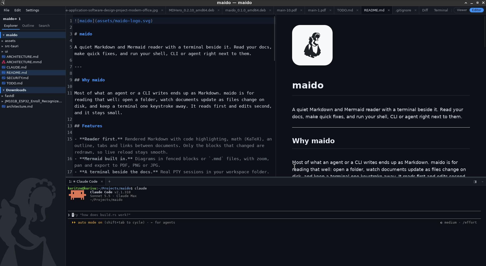

# maido

A quiet Markdown and Mermaid reader with a terminal beside it. Read your docs, make quick fixes, and run your shell, CLI or agent right next to them.

---

## Why maido

Most of what an agent or a CLI writes ends up as Markdown. maido is for reading that well: open a folder, watch documents update as files change on disk, and keep a terminal one keystroke away. It reads first and edits second, and it stays small.

## Features



### Reading
- **Rendered Markdown** with code highlighting, an outline, tabs and links between documents. Only the blocks that changed are redrawn, so live reload stays smooth, and what changed is flashed so you see what an agent just did.
- **Math** with KaTeX: `$…$`, `$$…$$` and `math` fences, typeset only when a document has any.
- **LaTeX files.** `.tex` documents open as readable documents with their math typeset, and are coloured in the editor. They are read, not compiled: see the [guide](GUIDE.md#latex).
- **Mermaid built in.** Diagrams in fenced blocks or `.mmd` files, with zoom, pan and export to PDF, PNG or JPG.
- **Pictures and PDFs** open as tabs too (PDFs are drawn page by page, only the pages near the view).
- **Themes and reading settings.** System, light or dark; serif or sans; text size and page margins.

### Working
- **More than one folder.** Add folders to a workspace; each sits under its own highlighted header in the Explorer, and quick open, search and live updates cover them all. Recent folders are one click away in *File > Open recent*.
- **An Explorer you can use.** Create, rename, cut, copy, paste and trash files from the tree; hidden and ignored files on demand.
- **A terminal beside the docs.** Real PTY sessions in your workspace folder. Paths in the output are clickable, and code blocks have a "send to terminal" button. An agent is just a program in a terminal.
- **An editor for quick fixes.** CodeMirror with a live preview beside it, scroll-synced, loaded only when you start editing. Saves never overwrite a change made on disk behind your back.
- **Find your way.** Quick open (`Ctrl+O`), a command palette (`Ctrl+Shift+P`), full-text search across the workspace, and find in the document with `3 of 12` counting and jump to a match by number.
- **Compare.** A diff window for files or pasted text, side by side or inline, also rendered for Markdown.
- **Follow mode.** Switch to each document as it changes on disk, to watch an agent work.
- **Print and export** to PDF.

### Small
- **Light on memory.** Tauri 2 and Svelte 5, with parsing, highlighting, search and terminals done in Rust. Mermaid, KaTeX, the editor and the terminal load only when used.
- **Safe by default.** Documents are sanitized, remote images ask first, and nothing outside the workspace is touched. See [`SECURITY.md`](SECURITY.md).

## Usage

```sh
maido .            # open the current folder
maido ~/notes      # open a folder
maido README.md    # open a file
```

### Keys

| Key | Action |
|---|---|
| `Ctrl+O` | Quick open a file |
| `Ctrl+Shift+P` | Command palette |
| `Ctrl+Shift+F` | Search in the workspace |
| `Ctrl+F` | Find in the document |
| `Ctrl+E` | Switch between viewer and editor |
| `Ctrl+S` | Save |
| `` Ctrl+` `` | Show or hide the terminal |
| `` Ctrl+Shift+` `` | New terminal |
| `Ctrl+=` `Ctrl+-` `Ctrl+0` | Font size: bigger, smaller, normal |
| `Ctrl+P` | Print as PDF |
| `Ctrl+W` | Close the tab |

Every command and shortcut is in the [guide](GUIDE.md).

## Install

Prebuilt packages (`.deb` and AppImage) are on the [Releases tab](https://github.com/kritzerenkrieg/maido/releases) of the GitHub repository. Download the latest one from there, or build it yourself below.

## Build

Requires Rust, Node, pnpm and Tauri's platform libraries (on Debian and Ubuntu: `libwebkit2gtk-4.1-dev` and friends).

```sh
pnpm install
pnpm dev        # development
pnpm build      # release binary, no bundle
pnpm release    # also builds the packages
```

## Learn more

- [`GUIDE.md`](GUIDE.md) lists every command and shortcut.
- [`ARCHITECTURE.md`](ARCHITECTURE.md) explains the design, and [`ARCHITECTURE.mmd`](ARCHITECTURE.mmd) draws it. Open it in maido.
- [`SECURITY.md`](SECURITY.md) is the threat model.

## License

[MIT](LICENSE)
